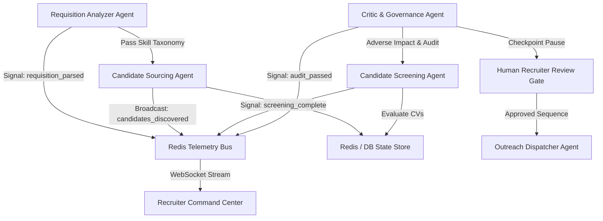

# DVT Talent AI — Agent Communication Fabric
**Version:** 2.0.0 (October 2026)  
**Agent Framework:** Pydantic AI 1.94.0  

---

## 1. Overview

The **Communication Fabric** enables a loosely coupled, event-driven architecture for the DVT Talent AI 5-agent recruitment swarm. Agents communicate via **Direct Context Sharing** for sequential pipeline handoffs and **Event-Driven Telemetry** for real-time visibility in the Recruiter Command Center.

---

## 2. Agent Interaction & Pipeline Topology

---

## 3. Shared Context & Pydantic AI Dependencies

Agents share critical resources and tenant isolation metadata via the `AgentDeps` structure passed through `RunContext`:

### Shared Dependencies:
- **HTTP Client**: Unified `httpx.AsyncClient` with connection pooling, retries, and rate-limiting.
- **Tenant ID**: Guarantees that candidate queries, ATS writes, and email sequences remain strictly isolated to the recruiter's tenant.
- **Provider Settings**: Configured fallback models (OpenAI, Anthropic, Groq, DeepSeek).
- **Privacy Filters**: Enforces exclusion of candidates who have toggled `is_searchable = false` or blacklisted the target employer's domain in `hide_from_companies`.

---

## 4. Telemetry Signals & Event Bus

The `EventBus` broadcasts real-time execution signals consumed by the frontend **Swarm Monitor** and **Neural Stream** via WebSockets:

| Signal Type | Description |
|---|---|
| `agent_start` | Broadcast when a specialized agent initiates a sequence. |
| `agent_info` | Granular progress updates (displayed in the Neural Stream). |
| `agent_success` | Confirmation of task stage completion. |
| `checkpoint_awaiting` | Notification that the workflow is paused awaiting recruiter sign-off. |
| `agent_error` | Graceful failure reports with recovery suggestions. |

---

## 5. Structured Data Integrity

By utilizing **Pydantic AI**, all agent inputs and outputs conform to strict Pydantic models. This guarantees:
- Zero data schema mismatch between sequential agents.
- Elimination of prompt injection and hallucinated field structures.
- Type-safe persistence into PostgreSQL and SQLite.
