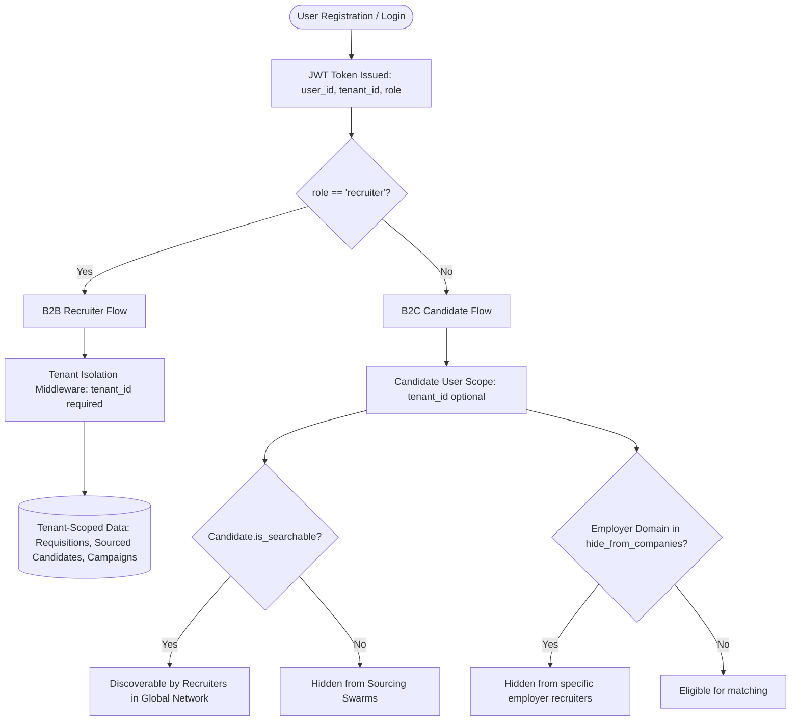

# DVT Talent AI — System Architecture Specification (Technical Deep Dive)
**Version:** 2.1.0 (October 2026)  
**Status:** Production Ready  

---

## 1. System Topology & Dual-Sided Platform Overview

DVT Talent AI is a production-grade, dual-sided AI talent platform that unifies **Recruiter & Agency Talent Acquisition (B2B)** with **Candidate Career Enablement (B2C Free Core)**.

```
┌────────────────────────────────────────────────────────────────────────┐
│                        EDGE INGRESS (Caddy Proxy)                      │
│        • Automatic TLS (Let's Encrypt) • HSTS & Security Headers       │
│        • Modern Compression (zstd/gzip) • Reverse Proxy & Upgrades     │
└──────────────────┬──────────────────────────────────┬──────────────────┘
                   │                                  │
                   ▼ (/*)                             ▼ (/api/*, /ws/*)
┌─────────────────────────────────────┐  ┌───────────────────────────────┐
│        NEXT.JS 14 WEB CLIENT        │  │     FASTAPI ASYNC API         │
├──────────────────┬──────────────────┤  ├───────────────────────────────┤
│ 💼 RECRUITER     │ 🎯 CANDIDATE     │  │ AUTH & IDENTITY:              │
│ DASHBOARD        │ PORTAL           │  │ • Role-Aware JWT & Blacklist  │
│ (/dashboard/*)   │ (/portal/*)      │  │ • Dual-Tenant Scoping         │
│ • Requisitions   │ • Job Board      │  │ • SAML SSO & OAuth2           │
│ • AI Sourcing    │ • 5D Match Score │  ├───────────────────────────────┤
│ • HITL Copilot   │ • Ghost Job Scan │  │ CORE DOMAIN ROUTERS:          │
│ • Bias Audit     │ • ATS CV Tailor  │  │ • /agents & /copilot          │
│ • Team Invites   │ • STAR Rehearsal │  │ • /jobs & /candidates         │
│ • ATS Sync       │ • Privacy Shield │  │ • /candidate-portal           │
│ • Dynamic /m/*   │ • Applications   │  │ • /compliance & /billing      │
└──────────────────┴──────────────────┘  └───────┬──────────────┬────────┘
                                                 │              │
                    ┌────────────────────────────┘              └───────────┐
                    ▼                                                       ▼
┌──────────────────────────────────────┐                ┌───────────────────────────────────┐
│     AUTONOMOUS AI SWARM ENGINE       │                │      PERSISTENCE & DATA LAYER     │
│          (Pydantic AI)               │                ├───────────────────────────────────┤
│ • MarketIQ & Discovery Agents        │                │ PRIMARY PRODUCTION DB:            │
│ • Sourcing Agent (Self-Healing Loop) │                │ • PostgreSQL 16 (dvt_talent)      │
│ • Critic Agent (Anti-Bias Audit)     │                │ • 26 Tables, 8 Enums, Alembic     │
│ • Outreach, Analytics, Screening     │                │ • Partial Unique Candidate Index  │
│ • Redis Semantic Swarm Memory        │                ├───────────────────────────────────┤
│ • LLM Guardrails (RPM/TPM + Breaker) │                │ STAGING & TEST DB:                │
└──────────────────┬───────────────────┘                │ • PostgreSQL 15 (dvt_staging)     │
                   │                                    ├───────────────────────────────────┤
                   ▼                                    │ IN-MEMORY & ASYNC QUEUE:          │
┌──────────────────────────────────────┐                │ • Redis 7 (Broker, Result Backend,│
│   CELERY ASYNC WORKER & BEAT         │                │   Semantic Cache, Pub/Sub Signals)│
│ • Background AI Pipelines            │                ├───────────────────────────────────┤
│ • Scheduled Discovery & Daily Runs   │                │ OBJECT & RESUME STORAGE:          │
│ • ATS Sync (Ashby, Greenhouse, Lever)│                │ • StorageService (Local / AWS S3) │
└──────────────────────────────────────┘                └───────────────────────────────────┘
```

---

## 2. Ingress & Edge Proxy Layer (`Caddyfile`)
- **Automated TLS & Security Headers:** Managed via Caddy with Let's Encrypt certificates, enforcing HTTP Strict Transport Security (`HSTS`), `X-Frame-Options: SAMEORIGIN`, and `X-Content-Type-Options: nosniff`.
- **Dynamic Compression:** Automatic payload compression using `zstd` and `gzip`.
- **Intelligent Reverse Proxy:**
  - `/api/*`, `/health*`, `/ping`: Routed upstream to FastAPI (`api:8000`).
  - `/api/v1/ws/*`: Routed upstream with WebSocket connection upgrades.
  - `/metrics`: Routed upstream for Prometheus scraping.
  - Catch-all `/*`: Routed upstream to Next.js (`frontend:3000`).

---

## 3. Dual-Persona Authentication & Authorization Boundaries

The platform operates across two distinct user personas with clearly delineated data boundaries:



### Authorization Rules
1. **Recruiter Role (`role: "recruiter"` / `"admin"` / `"manager"`)**:
   - Access: `/dashboard/*` web routes and `/api/v1/jobs`, `/api/v1/candidates`, `/api/v1/agents/*`, `/api/v1/copilot/*`, `/api/v1/billing/*`, `/api/v1/integrations/*`.
   - Data Scope: Strictly constrained to rows matching `tenant_id`.
2. **Candidate Role (`role: "candidate"`)**:
   - Access: `/portal/*` web routes and `/api/v1/candidate-portal/*`.
   - Data Scope: Constrained to the authenticated user's `Candidate` record linked via `Candidate.user_id == current_user.id`.
3. **Token Revocation & Logout**:
   - Calling `POST /api/v1/auth/logout` stores the JWT token ID in Redis with a TTL matching expiration.
   - `get_current_user` checks the Redis token blacklist on every protected request.

---

## 4. Autonomous AI Swarm Intelligence Architecture

The recruiter swarm automates candidate sourcing and screening using **Pydantic AI** with strict typing and structured outputs.

### The 7 Core Swarm Agents:
1. **`market_iq_agent` (`backend/agents/market_iq_pydantic.py`)**:
   - Analyzes macroeconomic talent dynamics, compensation benchmarks, and talent pool availability.
2. **`discovery_agent` (`backend/agents/discovery_pydantic.py`)**:
   - Ingests raw job requirements, extracts essential vs preferred skills, salary bands, and models hard technical constraints.
3. **`sourcing_agent` (`backend/agents/sourcing_pydantic.py`)**:
   - Scans candidate profiles across web nodes and internal databases.
   - Respects candidate privacy shields (`is_searchable == False` and `hide_from_companies`).
   - **Self-Healing Fallback Protocol:** If fewer than 3 candidates are discovered, the orchestrator triggers `discovery_agent` with loosened constraints and re-runs sourcing automatically.
4. **`critic_agent` (`backend/agents/critic_pydantic.py`)**:
   - Sanitizes candidate payloads (trims irrelevant PII to eliminate bias and hallucination) and validates qualification logic.
   - Monitors scoring for adverse impact against protected classes according to EEOC 4/5ths guidelines and logs immutable decision entries in `compliance_audits`.
5. **`outreach_agent` (`backend/agents/outreach_pydantic.py`)**:
   - Generates personalized multi-stage email drafts subject to human recruiter approval before transmission.
6. **`analytics_agent` (`backend/agents/analytics_pydantic.py`)**:
   - Generates post-run pipeline telemetry and efficiency reports.
7. **`screening_agent` (`backend/agents/screening_pydantic.py`)**:
   - Conducts technical and behavioral candidate assessments.

### Swarm Memory, Telemetry & Guardrails
- **Redis Semantic Shared Memory (`backend/agents/swarm_memory.py`):** Replaces legacy SQLite file memory with a distributed Redis semantic cache, supporting horizontal scaling across multi-container worker clusters.
- **WebSocket Telemetry Multiplexing (`backend/api/routes/websocket.py`):** Relays Redis `dvt_signals:{tenant_id}` events to all active browser sessions for each tenant (`Dict[str, Set[WebSocket]]`).
- **LLM Guardrails (`backend/services/llm_guardrail_service.py`):** Redis token bucket algorithm enforces RPM/TPM rate limits, while a circuit breaker prevents cascading timeouts if an upstream LLM provider degrades.

---

## 5. Career-Ops Candidate AI Engine

The Candidate Portal incorporates the specialized **Career-Ops AI Engine** located in `backend/api/routes/candidate_portal.py`:

1. **5-Dimension Scoring Engine:** Evaluates match across Title Alignment, Tech Stack, Years of Experience, Domain Expertise, and Cultural/Working Style.
2. **Ghost Job Detector (Block G):** Identifies stale listings, compliance placeholders, or unmonitored job postings based on posting age, description patterns, and cross-aggregator duplication.
3. **Zero-Fabrication ATS CV Tailor:** Analyzes CV against job requirements, identifying missing target keywords while preserving verified experience.
4. **STAR Behavioral Interview Flashcards:** Synthesizes structured Situation-Task-Action-Result prompts and answers for job-specific interviews.

---

## 6. Persistence & Data Isolation Layer

### Dual-Database Architecture
- **Staging / Testing:** PostgreSQL 15 Alpine (`dvt-postgres`), host port `5432`, database `dvt_staging`.
- **Production:** PostgreSQL 16 Alpine (`dvt_db`), internal port `5432`, database `dvt_talent` on dedicated volume `postgres_prod_data`.

### Schema & Candidate Isolation
- **26 Tables, 8 Enums:** Governed exclusively by Alembic migrations (current stamp: `007_team_invitations`).
- **Partial Unique Index:** Replaced global email uniqueness with `CREATE UNIQUE INDEX uq_candidate_tenant_email ON candidates (tenant_id, email) WHERE tenant_id IS NOT NULL;` ensuring true multi-tenant candidate isolation.
- **Unified Storage Service (`backend/services/storage_service.py`):** Pluggable drivers (`LocalStorageDriver` and `S3StorageDriver`) supporting AWS S3, MinIO, and Cloudflare R2 with streaming uploads and path traversal protection.
